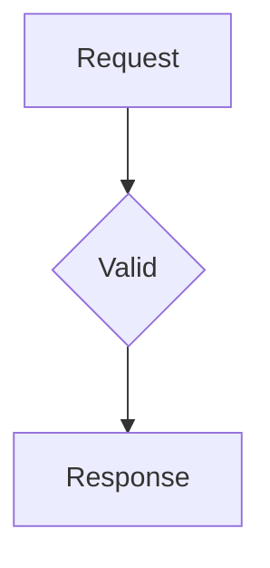
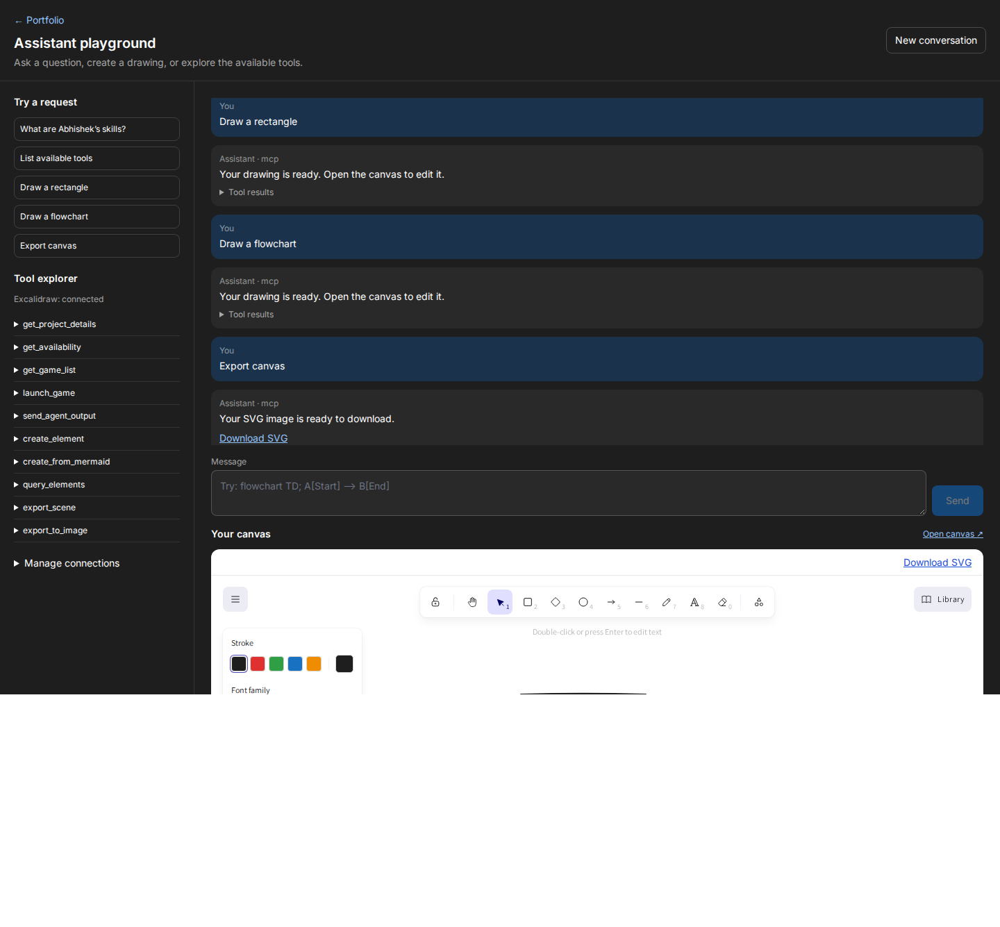
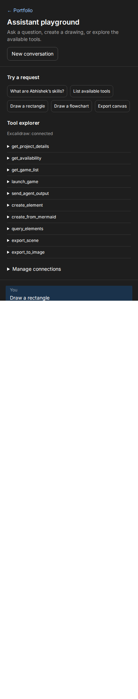

# Podfolio assistant and canvas

The portfolio and `/mcp` playground use `POST /api/chat` for ordinary questions, local tools and Excalidraw tools. The original NIM proxy and MCP agent chat paths remain available. The backend adds the portfolio context and calls NVIDIA NIM for generic answers. Local tool results and deterministic drawing actions do not spend a completion call.

## Local services

Use Node.js 20+ and install dependencies in both applications and `mcp-server-excalidraw`. Start the services in separate terminals:

```sh
# pod-mac-vite/pod
npm run dev
# pod-mac-vite/pod-backend
npm run dev
# mcp-server-excalidraw
npm run dev
```

The expected ports are frontend 5173, backend 3000 and canvas service 3001. Restart processes after dependency or entrypoint changes. An old Vite process may still reference removed chunk files after npm replaces its package; stopping and restarting Vite fixes that mixed-version process.

Backend `.env` needs `NVIDIA_NIM_API_KEY` and `RESEND_API_KEY`. Set `NVIDIA_NIM_MODEL` to a model available to your account. The embedding model is independently configurable with `NVIDIA_EMBEDDING_MODEL`. See `.env.example` files for service URLs. Keep your existing credentials private.

The built-in Excalidraw connection uses `EXCALIDRAW_MCP_URL=http://localhost:3001/mcp`. Remove or update any older `MCP_CONNECTIONS` entry with id `excalidraw`: an explicit connection configuration overrides the built-in one. In particular, the old `npx mcp-excalidraw-server` stdio scaffold is not the new HTTP service. The supported standalone entrypoint is `src/service.ts` / `dist/service.js`; older scaffold files are preserved locally.

Open http://localhost:5173/mcp or the assistant's playground link. Try “List available tools”, “Draw a rectangle”, “Draw a flowchart”, and “Export canvas”. Custom requests work in both the dock assistant and playground: for example, “create a flow diagram of manual testing”, “give me a flowchart for checkout”, or “visualize the deployment process”. The LLM generates a supported flowchart, the backend executes the drawing tool, and the response includes an editable canvas link. Recent conversation context is included for requests such as “turn this into a flow diagram”. Informational questions, explicit code-only requests, and disabled tools remain text responses. If the model provider is overloaded, the assistant reports that it is busy instead of claiming a drawing exists. You can also paste:



The demo supports basic Mermaid flowcharts with rectangle `[label]`, ellipse `(label)` and diamond `{label}` nodes and `-->` arrows. Unsupported Mermaid syntax fails explicitly. Each conversation owns an isolated canvas ID. Its URL is a capability: share it only with people who should access that drawing. The editor persists scene changes, refreshes immediately after playground tool actions, and checks for other updates every 30 seconds while visible. Hidden tabs pause background reads. A successful save does not trigger an extra GET. On HTTP 429, synchronization waits for the server’s Retry-After deadline (15 minutes if the header is unavailable), retaining pending edits; transient failures back off before retrying. Rejected saves (for example, an oversized scene) retain local edits and pause automatic retries until the drawing is edited again. Rate limiting remains enabled. SVG downloads contain the actual scene; fonts/roughness and complex editor styling may differ from the editor rendering. Scenes expire after 24 hours, are held in memory, and disappear on service restart. Export important drawings before restarting.

## Admin connections

Set `MCP_ADMIN_TOKEN` only in the backend environment. Open Settings → MCP Tools, or expand Manage connections in the playground, and enter that token. It is held in memory and cleared when the manager unmounts. Never use `VITE_MCP_ADMIN_TOKEN`; Vite variables are public bundle contents.

HTTP, legacy SSE and stdio connections can be configured. Stdio commands execute on the backend host; only trusted administrators should have this token. Connection settings live in memory unless supplied through `MCP_CONNECTIONS`. Public chat exposes the approved Excalidraw demo tools; arbitrary third-party tool execution requires the authenticated `/api/mcp/tools/call` endpoint. Responses never return environment or header secrets. Remote MCP credentials belong in backend configuration.

## Contracts

`POST /api/chat` accepts `{ messages: [{ role: 'user', content: 'Draw a rectangle' }], options: { conversationId: '<uuid>', useCache: true, useTools: true, stream: false } }`.

A successful response is `{ success: true, data: { message, toolCalls?, canvasUrl?, downloadUrl?, conversationId, source, cached } }`. Download URLs are relative to the backend. Send the same conversation ID for drawing, editing and export. Streaming is rejected; messages and tool payloads are bounded.

`POST /api/mcp/agent/chat` accepts the original message shape and top-level conversationId. Legacy `sendEmail:true` is rejected with guidance to explicitly request email in a message or use `POST /api/mcp/agent/send-output` with `{subject,content}`. Sending always targets the configured portfolio owner and is rate limited. Asking for contact details does not send email.

## Validation

Run root `npm run validate`. Run `npm run test:mcp-browser --prefix pod-mac-vite/pod` after builds for an isolated Chromium test using temporary local servers and provider stubs. It does not use real API credentials or send mail. Screenshots are written to `/tmp/podfolio-mcp-desktop.png` and `/tmp/podfolio-mcp-mobile.png`.

## Screenshots





## Backend diagnostics

The backend writes one JSON log record per event to stdout. Every HTTP request gets a generated `X-Request-ID` response header; filter terminal/hosting logs by `requestId` to follow it through LLM generation, MCP connection/tool execution and canvas proxying. `request.completed`, `request.failed` and `request.aborted` include duration, route template and HTTP status when a response completed. `operation.failed` includes a safe error code and upstream status where available. Email outcomes and cache/LLM/tool response sources are also recorded. Chat text, provider response bodies, credentials, query strings and canvas capability IDs are excluded.

The unified assistant allows 2048 output tokens so reasoning models have space to produce their final answer. `llm.response` records finish reason and completion token count. A `length` finish reason returns `LLM_RESPONSE_TRUNCATED` before invoking drawing tools; empty answers return `LLM_EMPTY_RESPONSE`. No automatic retries replay drawing actions.
